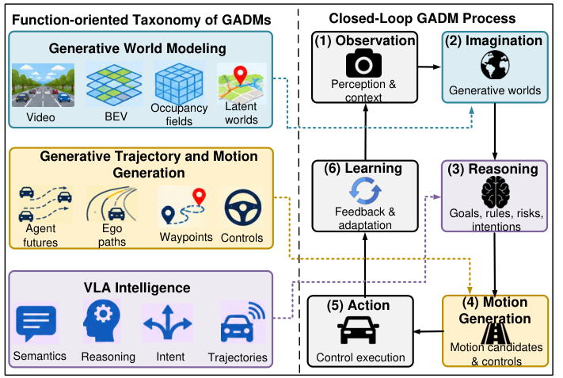

# Awesome Generative Autonomous Driving Models (GADMs)

### A Survey on Generative Autonomous Driving Models: Foundations, Taxonomy, and Convergence

[](https://github.com/gordonowusuboateng/generative-autonomous-driving-models/stargazers) [](https://github.com/gordonowusuboateng/generative-autonomous-driving-models/issues) [](https://github.com/gordonowusuboateng/generative-autonomous-driving-models/pulls) [](https://github.com/gordonowusuboateng/generative-autonomous-driving-models/commits/main)

**Gordon Owusu Boateng**, Qian Dong, Dongyao Jia, Xiansheng Guo, Azzam Mourad, and Nirwan Ansari

> 📚 The curated companion repository for the survey **A Survey on Generative Autonomous Driving Models: Foundations, Taxonomy, and Convergence** (2026 manuscript). It brings together generative world models, trajectory and motion generation, and vision-language-action (VLA) intelligence for autonomous driving and automated valet parking.

**[Browse papers](#paper-collections)** · **[Datasets & benchmarks](#datasets-benchmarks-and-evaluation)** · **[Full bibliography](bibliography.md)** · **[Download BibTeX](source-references.bib)** · **[Contribute a paper](CONTRIBUTING.md)**

> **Publication status:** The survey manuscript has not been assigned a publicly supplied URL or DOI. The repository does not claim publication or acceptance. Links below use author-supplied DOI/arXiv metadata; external resolution is not guaranteed.

## Contents

- [About this survey](#about-this-survey)
- [Latest additions and 2026 highlights](#latest-additions-and-2026-highlights)
- [Taxonomy and framework](#taxonomy-and-framework)
- [Paper collections](#paper-collections)
- [Generative world modeling](#generative-world-modeling)
- [Generative trajectory and motion planning](#generative-trajectory-and-motion-planning)
- [Vision-language-action intelligence](#vision-language-action-intelligence)
- [Functional convergence](#functional-convergence)
- [Datasets, benchmarks, and evaluation](#datasets-benchmarks-and-evaluation)
- [Related surveys](#related-surveys)
- [Contributing](#contributing)
- [Citation](#citation)

## About this survey

Generative Autonomous Driving Models (GADMs) can generate future scenes, occupancy, interacting agent trajectories, and driving actions. This survey organizes the literature into **three interrelated research directions** and studies when their interaction leads to meaningful **functional convergence** in autonomous driving.

**Key principle:** Sharing model backbones or features does not itself establish convergence. Generated futures and grounded reasoning must measurably influence closed-loop action selection, adaptation, or safety.

## Latest additions and 2026 highlights

Selected **2026 works from the supplied bibliography** (not a claim of weekly or exhaustive updates).

- **GenieDrive** (2026) — [bibliography pending link](bibliography.md)
- **OccSora** (2026) — [DOI](https://doi.org/10.1109/TIP.2026.3687468)
- **Hermes++** (2026) — [DOI](https://doi.org/10.1109/TPAMI.2026.3735606)
- **ParkDiffusion++** (2026) — [arXiv](https://arxiv.org/abs/2602.20923)
- **OpenDriveVLA** (2026) — [DOI](https://doi.org/10.1609/aaai.v40i16.38386)
- **PlanAgent** (2026) — [DOI](https://doi.org/10.1109/TCDS.2026.3664120)
- **DriveWorld-VLA** (2026) — [Paper](https://arxiv.org/abs/2602.06521)
- **V2X-VLM** (2026) — [DOI](https://doi.org/10.1016/j.trc.2025.105457)

## Taxonomy and framework

<p align="center"></p>

*Function-oriented taxonomy and conceptual closed-loop process (survey Fig. 2).*

**Observation → Imagination → Reasoning → Motion Generation → Action → Learning**

The six-stage process is a **functional abstraction**, not an architecture purported to be implemented by every paper.

| Research direction | Key questions | Detailed collection |
| :--- | :--- | :--- |
| **Generative world modeling** | What futures can the model generate, and how do candidate actions affect them? | [World modeling](world-modeling.md) |
| **Generative trajectory and motion planning** | How are multimodal trajectories generated, evaluated, and selected? | [Motion generation](trajectory-motion.md) |
| **VLA intelligence** | How do language and grounded semantic reasoning influence driving actions? | [VLA intelligence](vla-intelligence.md) |

## Paper collections

**Reading guide:** Each item lists a method, title where available, venue/year, and **[Paper]** (DOI or arXiv). **[Code]** is shown only where the supplied bibliography identifies an official repository. A missing link means it has not yet been supplied or verified, not that the publication or code is unavailable. Some works appear in multiple directions where research scopes overlap.

## Generative world modeling

### Visual and video world modeling

- **DriveGAN**, *CVPR, 2021*. [[Paper](https://doi.org/10.1109/CVPR46437.2021.00576)]
- **GAIA-1** — “GAIA-1: A Generative World Model for Autonomous Driving”, *arXiv, 2023*. [[Paper](https://arxiv.org/abs/2309.17080)]
- **GAIA-2** — “GAIA-2: A Controllable Multi-View Generative World Model for Autonomous Driving”, *arXiv, 2025*. [[Paper](https://arxiv.org/abs/2503.20523)]
- **UniSim** — “UniSim: A Neural Closed-Loop Sensor Simulator”, *CVPR, 2023*. [[Paper](https://doi.org/10.1109/CVPR52729.2023.00140)]
- **Drive-WM** — “Driving Into the Future: Multiview Visual Forecasting and Planning with World Model for Autonomous Driving”, *CVPR, 2024*. [[Paper](https://doi.org/10.1109/CVPR52733.2024.01397)]
- **DriveDreamer**, *ECCV, 2025*. [[Paper](https://doi.org/10.1007/978-3-031-73195-2_4)]
- **DrivingDiffusion**, *ECCV, 2025*. [[Paper](https://doi.org/10.1007/978-3-031-73229-4_27)]
- **Panacea** — “Panacea: Panoramic and Controllable Video Generation for Autonomous Driving”, *CVPR, 2024*. *Link pending*
- **WoVoGen**, *ECCV, 2025*. [[Paper](https://doi.org/10.1007/978-3-031-72989-8_19)]
- **Vista** — “Vista: A Generalizable Driving World Model with High Fidelity and Versatile Controllability”, *NeurIPS, 2024*. [[Paper](https://doi.org/10.52202/079017-2906)]
- **GenieDrive** — “GenieDrive: Towards Physics-Aware Driving World Model with 4D Occupancy Guided Video Generation”, *CVPR, 2026*. *Link pending*
- **DriveScape**, *CVPR, 2025*. [[Paper](https://doi.org/10.1109/CVPR52734.2025.01602)]
- **InstaDrive**, *ICCV, 2025*. [[Paper](https://doi.org/10.1109/ICCV51701.2025.02357)]
- **DriveDreamer4D**, *CVPR, 2025*. [[Paper](https://doi.org/10.1109/CVPR52734.2025.01122)]

### Geometric and occupancy world modeling

- **OccWorld** — “OccWorld: Learning a 3D Occupancy World Model for Autonomous Driving”, *ECCV, 2025*. [[Paper](https://doi.org/10.1007/978-3-031-72624-8_4)] [[Code](https://github.com/wzzheng/OccWorld)]
- **Drive-OccWorld** — “Driving in the Occupancy World: Vision-Centric 4D Occupancy Forecasting and Planning via World Models for Autonomous Driving”, *AAAI, 2025*. [[Paper](https://doi.org/10.1609/aaai.v39i9.33010)]
- **DOME**, *arXiv, 2024*. [[Paper](https://arxiv.org/abs/2410.10429)]
- **OccSora** — “OccSora: 4D Occupancy Generation Models as World Simulators for Autonomous Driving”, *IEEE Trans. Image Processing, 2026*. [[Paper](https://doi.org/10.1109/TIP.2026.3687468)]
- **DIO** — “DIO: Decomposable Implicit 4D Occupancy-Flow World Model”, *CVPR, 2025*. [[Paper](https://doi.org/10.1109/CVPR52734.2025.02557)]
- **DynamicCity**, *ICLR, 2025*. *Link pending*
- **UniScene**, *CVPR, 2025*. [[Paper](https://doi.org/10.1109/CVPR52734.2025.01118)]
- **DriveWorld**, *CVPR, 2024*. [[Paper](https://doi.org/10.1109/CVPR52733.2024.01470)]
- **Hermes++**, *TPAMI, 2026*. [[Paper](https://doi.org/10.1109/TPAMI.2026.3735606)]

### Latent, agent-centric, and interactive world modeling

- **MILE**, *NeurIPS, 2022*. [[Paper](https://doi.org/10.52202/068431-1505)]
- **BEVWorld** — “BEVWorld: A Multimodal World Simulator for Autonomous Driving via Scene-Level BEV Latents”, *arXiv, 2025*. [[Paper](https://arxiv.org/abs/2407.05679)]
- **TrafficBots**, *ICRA, 2023*. [[Paper](https://doi.org/10.1109/ICRA48891.2023.10161243)]
- **SceneDiffuser**, *NeurIPS, 2024*. [[Paper](https://doi.org/10.52202/079017-1771)]
- **SceneDiffuser++**, *CVPR, 2025*. [[Paper](https://doi.org/10.1109/CVPR52734.2025.00154)]
- **Think2Drive**, *ECCV, 2024*. *Link pending*
- **CarDreamer**, *IEEE Internet of Things Journal, 2025*. [[Paper](https://doi.org/10.1109/JIOT.2024.3479088)]
- **OccLLaMA** — “OccLLaMA: An Occupancy-Language-Action Generative World Model for Autonomous Driving”, *arXiv, 2024*. [[Paper](https://arxiv.org/abs/2409.03272)]

**More detail:** [Generative world modeling collection](world-modeling.md).

## Generative trajectory and motion planning

### Multimodal agent trajectory prediction

- **DESIRE**, *CVPR, 2017*. *Link pending*
- **Trajectron++** — “Trajectron++: Dynamically-Feasible Trajectory Forecasting with Heterogeneous Data”, *ECCV, 2020*. [[Paper](https://doi.org/10.1007/978-3-030-58523-5_40)]
- **MultiPath++**, *ICRA, 2022*. [[Paper](https://doi.org/10.1109/ICRA46639.2022.9812107)]
- **AgentFormer**, *ICCV, 2021*. *Link pending*
- **MotionDiffuser** — “MotionDiffuser: Controllable Multi-Agent Motion Prediction Using Diffusion”, *CVPR, 2023*. *Link pending*
- **MotionLM** — “MotionLM: Multi-Agent Motion Forecasting as Language Modeling”, *ICCV, 2023*. [[Paper](https://doi.org/10.1109/ICCV51070.2023.00788)]
- **ParkDiffusion** — “ParkDiffusion: Heterogeneous Multi-Agent Multi-Modal Trajectory Prediction for Automated Parking using Diffusion Models”, *IROS, 2025*. [[Paper](https://doi.org/10.1109/IROS60139.2025.11246467)]
- **ParkDiffusion++** — “ParkDiffusion++: Ego Intention Conditioned Joint Multi-Agent Trajectory Prediction for Automated Parking using Diffusion Models”, *arXiv, 2026*. [[Paper](https://arxiv.org/abs/2602.20923)]
- **Leapfrog Diffusion**, *CVPR, 2023*. [[Paper](https://doi.org/10.1109/CVPR52729.2023.00534)]
- **Heteroscedastic Diffusion**, *TPAMI, 2026*. [[Paper](https://doi.org/10.1109/TPAMI.2026.3692903)]

### Generative ego-motion and end-to-end planning

- **VADv2**, *ICLR, 2026*. *Link pending*
- **Diffusion-ES** — “Diffusion-ES: Gradient-Free Planning with Diffusion for Autonomous and Instruction-Guided Driving”, *CVPR, 2024*. [[Paper](https://doi.org/10.1109/CVPR52733.2024.01453)]
- **DiffusionDrive** — “DiffusionDrive: Truncated Diffusion Model for End-to-End Autonomous Driving”, *CVPR, 2025*. [[Paper](https://doi.org/10.1109/CVPR52734.2025.01124)]
- **GoalFlow** — “GoalFlow: Goal-Driven Flow Matching for Multimodal Trajectories Generation in End-to-End Autonomous Driving”, *CVPR, 2025*. [[Paper](https://doi.org/10.1109/CVPR52734.2025.00157)]
- **Diffusion Planner**, *ICLR, 2025*. *Link pending*
- **GenAD** — “GenAD: Generative End-to-End Autonomous Driving”, *ECCV, 2025*. [[Paper](https://doi.org/10.1007/978-3-031-73650-6_6)] [[Code](https://github.com/wzzheng/GenAD)]
- **DriveGPT**, *ICML, 2025*. [[Paper](https://raw.githubusercontent.com/mlresearch/v267/main/assets/huang25ak/huang25ak.pdf)]

### Joint prediction, interaction, and planning

- **DTPP** — “DTPP: Differentiable Joint Conditional Prediction and Cost Evaluation for Tree Policy Planning in Autonomous Driving”, *ICRA, 2024*. [[Paper](https://doi.org/10.1109/ICRA57147.2024.10610550)]
- **GameFormer**, *ICCV, 2023*. [[Paper](https://doi.org/10.1109/ICCV51070.2023.00361)]
- **DrivingGPT** — “DrivingGPT: Unifying Driving World Modeling and Planning with Multi-Modal Autoregressive Transformers”, *ICCV, 2025*. [[Paper](https://doi.org/10.1109/ICCV51701.2025.02496)]

**More detail:** [Generative trajectory and motion planning collection](trajectory-motion.md).

## Vision-language-action intelligence

### Semantic grounding and driving reasoning

- **Talk2BEV** — “Talk2BEV: Language-enhanced Bird’s-eye View Maps for Autonomous Driving”, *ICRA, 2024*. [[Paper](https://doi.org/10.1109/ICRA57147.2024.10611485)]
- **DriveLM** — “DriveLM: Driving with Graph Visual Question Answering”, *ECCV, 2025*. [[Paper](https://doi.org/10.1007/978-3-031-72943-0_15)] [[Code](https://github.com/OpenDriveLab/DriveLM)]
- **Reason2Drive** — “Reason2Drive: Towards Interpretable and Chain-Based Reasoning for Autonomous Driving”, *ECCV, 2025*. [[Paper](https://doi.org/10.1007/978-3-031-73347-5_17)]
- **LingoQA**, *ECCV, 2024*. [[Paper](https://doi.org/10.1007/978-3-031-72980-5_15)] [[Code](https://github.com/wayveai/LingoQA)]
- **GPT-Driver**, *arXiv, 2023*. [[Paper](https://arxiv.org/abs/2310.01415)]
- **DriveVLM** — “DriveVLM: The Convergence of Autonomous Driving and Large Vision-Language Models”, *arXiv, 2024*. [[Paper](https://arxiv.org/abs/2402.12289)]

### Language-conditioned action and trajectory generation

- **LMDrive** — “LMDrive: Closed-Loop End-to-End Driving with Large Language Models”, *CVPR, 2024*. [[Paper](https://doi.org/10.1109/CVPR52733.2024.01432)]
- **VLP**, *CVPR, 2024*. [[Paper](https://doi.org/10.1109/CVPR52733.2024.01398)]
- **ORION** — “Orion: A Holistic End-To-End Autonomous Driving Framework by Vision-Language Instructed Action Generation”, *ICCV, 2025*. [[Paper](https://doi.org/10.1109/ICCV51701.2025.02302)]
- **AutoVLA** — “AutoVLA: A Vision-Language-Action Model for End-to-End Autonomous Driving with Adaptive Reasoning and Reinforcement Fine-Tuning”, *NeurIPS, 2025*. [[Paper](https://doi.org/10.52202/085713-0942)]
- **OpenDriveVLA** — “OpenDriveVLA: Towards End-to-End Autonomous Driving with Large Vision Language Action Model”, *AAAI, 2026*. [[Paper](https://doi.org/10.1609/aaai.v40i16.38386)]

### Agentic, cooperative, and world-grounded intelligence

- **DiLu**, *ICLR, 2024*. *Link pending*
- **Agent-Driver**, *arXiv, 2024*. [[Paper](https://arxiv.org/abs/2311.10813)]
- **PlanAgent**, *IEEE Trans. Cognitive and Developmental Systems, 2026*. [[Paper](https://doi.org/10.1109/TCDS.2026.3664120)]
- **V2X-VLM**, *Transportation Research Part C: Emerging Technologies, 2026*. [[Paper](https://doi.org/10.1016/j.trc.2025.105457)]
- **OccLLaMA** — “OccLLaMA: An Occupancy-Language-Action Generative World Model for Autonomous Driving”, *arXiv, 2024*. [[Paper](https://arxiv.org/abs/2409.03272)]
- **DriveWorld-VLA** — “DriveWorld-VLA: Unified Latent-Space World Modeling with Vision-Language-Action for Autonomous Driving”, *arXiv, 2026*. [[Paper](https://arxiv.org/abs/2602.06521)]

**More detail:** [Vision-language-action intelligence collection](vla-intelligence.md).

## Functional convergence

| Convergence property | Evaluation question |
| :--- | :--- |
| **Action sensitivity** | Do changes in candidate ego actions alter the generated future? |
| **Semantic–geometric consistency** | Are language-level intentions grounded in scene geometry and dynamics? |
| **Consequence-aware action selection** | Do predicted consequences change the chosen action? |
| **Closed-loop adaptation** | Does execution feedback influence the next decision? |

**Illustrative studies** (inclusion does not establish that all four properties have been demonstrated):

- **Drive-WM** — “Driving Into the Future: Multiview Visual Forecasting and Planning with World Model for Autonomous Driving”, *CVPR, 2024*. [[Paper](https://doi.org/10.1109/CVPR52733.2024.01397)]
- **Drive-OccWorld** — “Driving in the Occupancy World: Vision-Centric 4D Occupancy Forecasting and Planning via World Models for Autonomous Driving”, *AAAI, 2025*. [[Paper](https://doi.org/10.1609/aaai.v39i9.33010)]
- **DriveVLM** — “DriveVLM: The Convergence of Autonomous Driving and Large Vision-Language Models”, *arXiv, 2024*. [[Paper](https://arxiv.org/abs/2402.12289)]
- **OccLLaMA** — “OccLLaMA: An Occupancy-Language-Action Generative World Model for Autonomous Driving”, *arXiv, 2024*. [[Paper](https://arxiv.org/abs/2409.03272)]
- **World4Drive** — “World4Drive: End-to-End Autonomous Driving via Intention-Aware Physical Latent World Model”, *ICCV, 2025*. [[Paper](https://doi.org/10.1109/ICCV51701.2025.02659)]
- **DrivingGPT** — “DrivingGPT: Unifying Driving World Modeling and Planning with Multi-Modal Autoregressive Transformers”, *ICCV, 2025*. [[Paper](https://doi.org/10.1109/ICCV51701.2025.02496)]
- **DriveWorld-VLA** — “DriveWorld-VLA: Unified Latent-Space World Modeling with Vision-Language-Action for Autonomous Driving”, *arXiv, 2026*. [[Paper](https://arxiv.org/abs/2602.06521)]

**More detail:** [Functional convergence collection](convergence.md).

## Datasets, benchmarks, and evaluation

| Resource | Examples or focus | Full list |
| :--- | :--- | :--- |
| **Datasets** | nuScenes, PandaSet, Argoverse 2, nuScenes-QA, Occ3D | [Datasets](datasets.md) |
| **Benchmarks and simulators** | CARLA, nuPlan, NAVSIM, Bench2Drive, DriveArena | [Benchmarks](benchmarks.md) |
| **Metrics** | Generative fidelity, trajectory quality, planning, closed-loop safety | [Evaluation metrics](evaluation-metrics.md) |
| **Last-mile application** | Generative modeling and planning for automated valet parking | [Automated valet parking](automated-valet-parking.md) |

## Related surveys

- “End-to-End Autonomous Driving: Challenges and Frontiers,” *TPAMI, 2024*. [[Paper](https://doi.org/10.1109/TPAMI.2024.3435937)]
- “Generative AI for Autonomous Driving: Frontiers and Opportunities,” *ACM Computing Surveys, 2026*. [[Paper](https://doi.org/10.1145/3838726)]
- “World Models for Autonomous Driving: An Initial Survey,” *IEEE T-IV, 2024*. [[Paper](https://doi.org/10.1109/TIV.2024.3398357)]
- “A Survey on Vision-Language-Action Models for Embodied AI,” *IEEE TNNLS, 2026*. [[Paper](https://doi.org/10.1109/TNNLS.2025.3650584)]
- “A Survey on Efficient Vision-Language-Action Models,” *IEEE TPAMI, 2026*. [[Paper](https://doi.org/10.1109/TPAMI.2026.3734740)]
- “Foundation Models for Autonomous Driving: A Comprehensive Survey,” *EAAI, 2026*. [[Paper](https://doi.org/10.1016/j.engappai.2026.114805)]

See the [full bibliography](bibliography.md) for the full collection, including foundational generative models, motion planning, datasets, and benchmarks.

## Contributing

We welcome corrections and additions! Open an [issue](https://github.com/gordonowusuboateng/generative-autonomous-driving-models/issues) or a [pull request](https://github.com/gordonowusuboateng/generative-autonomous-driving-models/pulls) using the conventions in **[CONTRIBUTING.md](CONTRIBUTING.md)**. Please specify the paper title, DOI/arXiv URL, publication venue/year, taxonomy placement, and an official code link where available.

## Citation

Please cite the accompanying survey if it supports your research. **Provisional BibTeX** (replace with the official record once publicly released):

```bibtex
@misc{boateng2026gadms,
  title  = {A Survey on Generative Autonomous Driving Models: Foundations, Taxonomy, and Convergence},
  author = {Boateng, Gordon Owusu and Dong, Qian and Jia, Dongyao and Guo, Xiansheng and Mourad, Azzam and Ansari, Nirwan},
  year   = {2026},
  note   = {Manuscript}
}
```

---

**Maintenance note:** Publication links and years reflect author-supplied source metadata. ECCV proceedings metadata can use a later Springer publication year than the conference event. New entries should be reviewed before inclusion.
