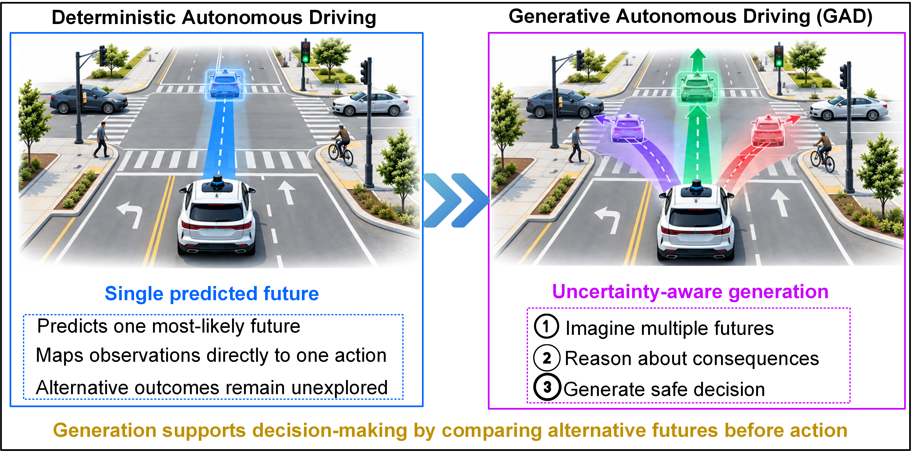
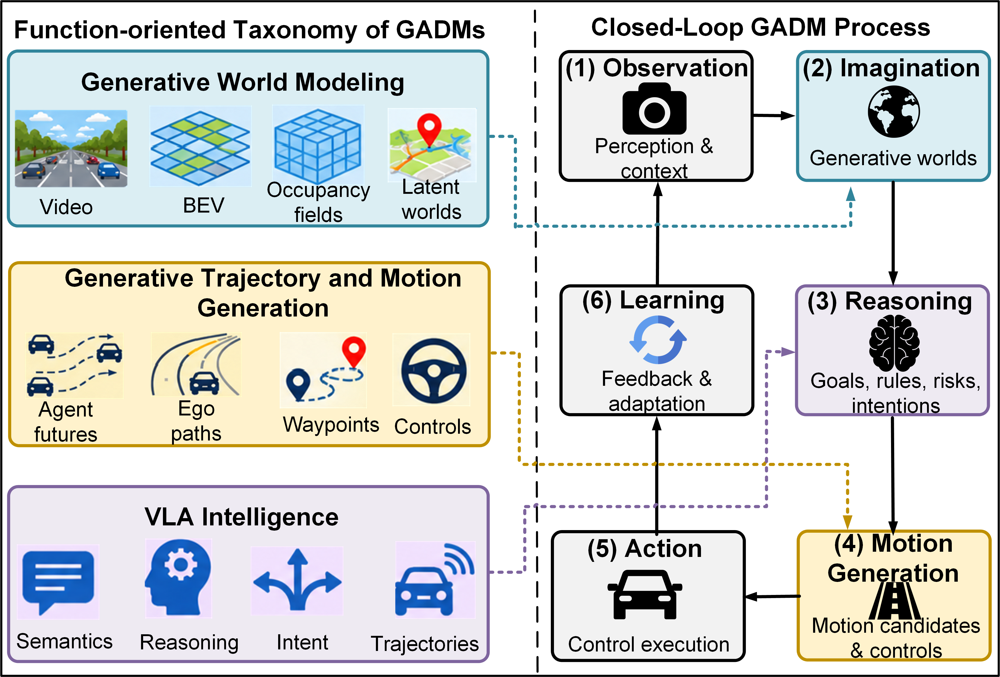
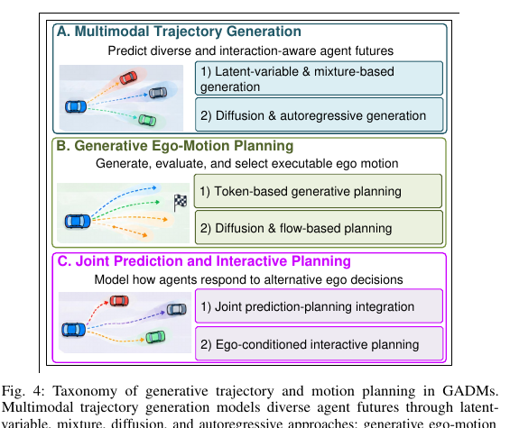
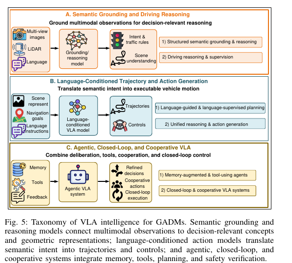
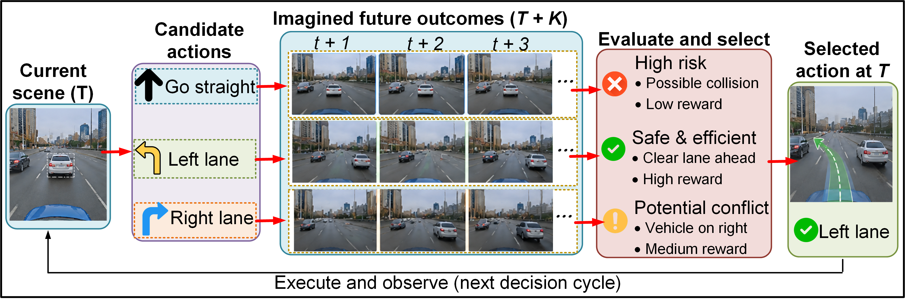

# Generative Autonomous Driving Models (GADMs)

### A Survey on Generative Autonomous Driving Models: Foundations, Taxonomy, and Convergence

[](https://github.com/gordonowusuboateng/gadms/stargazers) [](https://github.com/gordonowusuboateng/gadms/issues) [](https://github.com/gordonowusuboateng/gadms/pulls) [](https://github.com/gordonowusuboateng/gadms/commits/main)


**Gordon Owusu Boateng<sup>1</sup>, Qian Dong<sup>1</sup>, Dongyao Jia<sup>1</sup>, Xiansheng Guo<sup>2</sup>, Azzam Mourad<sup>3</sup>, Nirwan Ansari<sup>4</sup>**

1. Academy of AI and Advanced Technology, Xi'an Jiaotong-Liverpool University, Suzhou, 215123, China.
2. School of Information and Communication Engineering, University of Electronic Science and Technology of China, Chengdu, 611731, China.
3. Department of Computer Science, Khalifa University, Abu Dhabi, UAE.
4. Advanced Networking Lab, Department of Electrical and Computer Engineering, New Jersey Institute of Technology, Newark, NJ 07102, USA.

**Corresponding author:** Gordon Owusu Boateng ([Gordon.Boateng@xjtlu.edu.cn](mailto:Gordon.Boateng@xjtlu.edu.cn))


📚 This repository serves as the curated research companion to **A Survey on Generative Autonomous Driving Models: Foundations, Taxonomy, and Convergence**. It provides a systematically organized collection of research papers, datasets, benchmarks, and evaluation resources spanning three interconnected directions: **generative world modeling**, **generative trajectory and motion planning**, and **Vision-Language-Action (VLA) intelligence**. Beyond cataloging existing studies, the repository highlights their emerging functional convergence toward unified, intelligent, and closed-loop autonomous driving systems, including applications to **Automated Valet Parking (AVP)**. The collection will be updated to reflect new developments and emerging research directions.

**[Browse papers](#paper-collections)** · **[Datasets & benchmarks](#datasets-benchmarks-and-evaluation)** · **[Full bibliography](bibliography.md)** · **[Contribute a paper](CONTRIBUTING.md)**


📢 **Publication and Repository Updates:** This repository accompanies our survey, **A Survey on Generative Autonomous Driving Models: Foundations, Taxonomy, and Convergence**, currently available as a research manuscript. We maintain this collection as an evolving resource for the research community, incorporating relevant publications, datasets, benchmarks, and emerging developments in generative autonomous driving.

📝 **Contributions are welcome!** Feel free to submit [pull requests](https://github.com/gordonowusuboateng/gadms/pulls) or contact us via [email](mailto:Gordon.Boateng@xjtlu.edu.cn) to suggest new papers, contribute research resources, or report corrections. Please refer to our [contribution guidelines](https://github.com/gordonowusuboateng/gadms/blob/main/CONTRIBUTING.md).

⭐ **Support this repository!** If you find this collection useful, please consider [citing our survey](https://github.com/gordonowusuboateng/gadms#citation), [starring the repository](https://github.com/gordonowusuboateng/gadms), and sharing it with the research community. Your contributions and support will help keep this resource comprehensive, accurate, and up to date.


## Contents

- [About this survey](#about-this-survey)
- [Latest additions and 2026 highlights](#latest-additions-and-2026-highlights)
- [Taxonomy and framework](#taxonomy-and-framework)
- [Paper collections](#paper-collections)
- [Generative world modeling](#generative-world-modeling)
- [Generative trajectory and motion planning](#generative-trajectory-and-motion-planning)
- [Vision-language-action intelligence](#vision-language-action-intelligence)
- [Functional convergence](#functional-convergence)
- [Datasets, benchmarks, and evaluation](#datasets-benchmarks-and-evaluation)
- [Related surveys](#related-surveys)
- [Contributing](#contributing)
- [Citation](#citation)

## About this survey

Generative Autonomous Driving Models (GADMs) can generate future scenes, occupancy, interacting agent trajectories, and driving actions. This survey organizes the literature into **three interrelated research directions** and studies when their interaction leads to meaningful **functional convergence** in autonomous driving scenarios.

<p align="center">
  
</p>

*Fig. 1. Transition from deterministic autonomous driving to GAD. Whereas deterministic systems map observations to a single predicted future and action, GAD represents multiple plausible futures, reasons about their
    consequences, and generates safety-aware decisions under uncertainty.*


## Latest additions and 2026 highlights

Selected **2026 related work**.

- **GenieDrive** (2026) — [arXiv](https://arxiv.org/abs/2512.12751)
- **OccSora** (2026) — [DOI](https://doi.org/10.1109/TIP.2026.3687468)
- **Hermes++** (2026) — [DOI](https://doi.org/10.1109/TPAMI.2026.3735606)
- **ParkDiffusion++** (2026) — [arXiv](https://arxiv.org/abs/2602.20923)
- **OpenDriveVLA** (2026) — [DOI](https://doi.org/10.1609/aaai.v40i16.38386)
- **PlanAgent** (2026) — [DOI](https://doi.org/10.1109/TCDS.2026.3664120)
- **DriveWorld-VLA** (2026) — [Paper](https://arxiv.org/abs/2602.06521)
- **V2X-VLM** (2026) — [DOI](https://doi.org/10.1016/j.trc.2025.105457)

## Taxonomy and framework

<p align="center"></p>

*Fig. 2. Function-oriented taxonomy and closed-loop process of GADMs. Imagination, Reasoning, and Motion Generation correspond broadly to generative world modeling, VLA intelligence, and generative trajectory and motion planning, respectively, while Observation, Action, and Learning represent shared system-level functions.*

| Research direction | Key questions | Detailed collection |
| :--- | :--- | :--- |
| **Generative world modeling** | What futures can the model generate, and how do candidate actions affect them? | [World modeling](world-modeling.md) |
| **Generative trajectory and motion planning** | How are multimodal trajectories generated, evaluated, and selected? | [Motion generation](trajectory-motion.md) |
| **VLA intelligence** | How do language and grounded semantic reasoning influence driving actions? | [VLA intelligence](vla-intelligence.md) |


## Paper collections

**Reading guide:** Each item lists a method, title where available, venue/year, and **[Paper]** (DOI or arXiv). **[Code]** is shown only where the authors identify an official repository. Some works appear in multiple directions where research scopes overlap.

## Generative world modeling

<p align="center">
  
</p>

*Fig. 3. Taxonomy of visual, geometric and occupancy, and latent and agent-centric generative world models.*

### Visual and video world modeling

- **DriveGAN** — Kim, Seung Wook and Philion, Jonah and Torralba, Antonio and Fidler, Sanja. “DriveGAN: Towards a Controllable High-Quality Neural Simulation.” In *2021 IEEE/CVF Conference on Computer Vision and Pattern Recognition (CVPR)*, pp. 5816-5825, 2021. [[Paper](https://doi.org/10.1109/CVPR46437.2021.00576)]
- **GAIA-1** — Anthony Hu and Lloyd Russell and Hudson Yeo and Zak Murez and George Fedoseev and Alex Kendall and Jamie Shotton and Gianluca Corrado. “GAIA-1: A Generative World Model for Autonomous Driving.” *arXiv preprint*, 2023.  [[Paper](https://arxiv.org/abs/2309.17080)]
- **GAIA-2** — Lloyd Russell and Anthony Hu and Lorenzo Bertoni and George Fedoseev and Jamie Shotton and Elahe Arani and Gianluca Corrado. “GAIA-2: A Controllable Multi-View Generative World Model for Autonomous Driving.” *arXiv preprint*, 2025.  [[Paper](https://arxiv.org/abs/2503.20523)]
- **UniSim** — Yang, Ze and Chen, Yun and Wang, Jingkang and Manivasagam, Sivabalan and Ma, Wei-Chiu and Yang, Anqi Joyce and Urtasun, Raquel. “UniSim: A Neural Closed-Loop Sensor Simulator.” In *2023 IEEE/CVF Conference on Computer Vision and Pattern Recognition (CVPR)*, pp. 1389-1399, 2023. [[Paper](https://doi.org/10.1109/CVPR52729.2023.00140)]
- **Drive-WM** — Wang, Yuqi and He, Jiawei and Fan, Lue and Li, Hongxin and Chen, Yuntao and Zhang, Zhaoxiang. “Driving Into the Future: Multiview Visual Forecasting and Planning with World Model for Autonomous Driving.” In *2024 IEEE/CVF Conference on Computer Vision and Pattern Recognition (CVPR)*, pp. 14749-14759, 2024. [[Paper](https://doi.org/10.1109/CVPR52733.2024.01397)]
- **DriveDreamer** — Wang, Xiaofeng, Zheng Zhu, Guan Huang, Xinze Chen, Jiagang Zhu, Zhenya Yang, and Xiang Bai. “DriveDreamer: Towards Real-world-driven Interaction and Video Generation for Autonomous Driving.” In *European Conference on Computer Vision (ECCV)*, 2025. [[Paper](https://doi.org/10.1007/978-3-031-73195-2_4)]
- **DrivingDiffusion** — Dong, Haibin, Xiaofeng Wu, Yuhan Zhang, Chaoda Zheng, Yi Liao, and Junhao Huang. “DrivingDiffusion: Layout-Guided Multi-View Driving Scene Video Generation with Latent Diffusion Model.” In *European Conference on Computer Vision (ECCV)*, 2025. [[Paper](https://doi.org/10.1007/978-3-031-73229-4_27)]
- **Panacea** — Wen, Yuqing and Zhao, Yucheng and Liu, Yingfei and Jia, Fan and Wang, Yanhui and Luo, Chong and Zhang, Chi and Wang, Tiancai and Sun, Xiaoyan and Zhang, Xiangyu. “Panacea: Panoramic and Controllable Video Generation for Autonomous Driving.” In *Proceedings of the IEEE/CVF Conference on Computer Vision and Pattern Recognition (CVPR)*, pp. 6902-6912, 2024.
- **WoVoGen** — Lu, Xingchao, Siyu Bian, Yonglong Tian, and Tao Chen. “WoVoGen: World Volume-aware Diffusion for Controllable Multi-camera Driving Scene Generation.” In *European Conference on Computer Vision (ECCV)*, 2025. [[Paper](https://doi.org/10.1007/978-3-031-72989-8_19)]
- **Vista** — Gao, Shenyuan and Yang, Jiazhi and Chen, Li and Chitta, Kashyap and Qiu, Yihang and Geiger, Andreas and Zhang, Jun and Li, Hongyang. “Vista: A Generalizable Driving World Model with High Fidelity and Versatile Controllability.” In *Advances in Neural Information Processing Systems*, pp. 91560--91596, 2024. [[Paper](https://doi.org/10.52202/079017-2906)]
- **GenieDrive** — Yang, Zhenya and Liu, Zhe and Lu, Yuxiang and Hou, Liping and Miao, Chenxuan and Peng, Siyi and Feng, Bailan and Bai, Xiang and Zhao, Hengshuang. “GenieDrive: Towards Physics-Aware Driving World Model with 4D Occupancy Guided Video Generation.” In *Proceedings of the IEEE/CVF Conference on Computer Vision and Pattern Recognition (CVPR)*, pp. 35680-35690, 2026.
- **DriveScape** — Wu, Wei and Guo, Xi and Tang, Weixuan and Huang, Tingxuan and Wang, Chiyu and Ding, Chenjing. “DriveScape: High-Resolution Driving Video Generation by Multi-View Feature Fusion.” In *2025 IEEE/CVF Conference on Computer Vision and Pattern Recognition (CVPR)*, pp. 17187-17196, 2025. [[Paper](https://doi.org/10.1109/CVPR52734.2025.01602)]
- **InstaDrive** — Yang, Zhuoran and Guo, Xi and Ding, Chenjing and Wang, Chiyu and Wu, Wei and Zhang, Yanyong. “InstaDrive: Instance-Aware Driving World Models for Realistic and Consistent Video Generation.” In *2025 IEEE/CVF International Conference on Computer Vision (ICCV)*, pp. 25410-25420, 2025. [[Paper](https://doi.org/10.1109/ICCV51701.2025.02357)]
- **DriveDreamer4D** — Zhao, Guosheng and Ni, Chaojun and Wang, Xiaofeng and Zhu, Zheng and Zhang, Xueyang and Wang, Yida and Huang, Guan and Chen, Xinze and Wang, Boyuan and Zhang, Youyi and Mei, Wenjun and Wang, Xingang. “DriveDreamer4D: World Models Are Effective Data Machines for 4D Driving Scene Representation.” In *2025 IEEE/CVF Conference on Computer Vision and Pattern Recognition (CVPR)*, pp. 12015-12026, 2025. [[Paper](https://doi.org/10.1109/CVPR52734.2025.01122)]

### Geometric and occupancy world modeling

- **OccWorld** — Zheng, Wenzhao, et al. “OccWorld: Learning a 3D Occupancy World Model for Autonomous Driving.” In *European Conference on Computer Vision (ECCV)*, 2025. [[Paper](https://doi.org/10.1007/978-3-031-72624-8_4)] [[Code](https://github.com/wzzheng/OccWorld)]
- **Drive-OccWorld** — Yu Yang and Jianbiao Mei and Yukai Ma and Siliang Du                and Wenqing Chen and Yijie Qian and Yuxiang Feng                and Yong Liu. “Driving in the Occupancy World: Vision-Centric 4D                Occupancy Forecasting and Planning via World Models                for Autonomous Driving.” In *Proceedings of the AAAI Conference on Artificial                Intelligence*, pp. 9327--9335, 2025. [[Paper](https://doi.org/10.1609/aaai.v39i9.33010)]
- **DOME** — Wang, Xiao, et al. “DOME.” *arXiv preprint*, 2024. [[Paper](https://arxiv.org/abs/2410.10429)]
- **OccSora** — Wang, Lening and Zheng, Wenzhao and Ren, Yilong and Jiang, Han and Cui, Zhiyong and Yu, Haiyang and Lu, Jiwen. “OccSora: 4D Occupancy Generation Models as World Simulators for Autonomous Driving.” In *IEEE Transactions on Image Processing*, pp. 4947-4960, 2026. [[Paper](https://doi.org/10.1109/TIP.2026.3687468)]
- **DIO** — Diehl, Christopher and Sykora, Quinlan and Agro, Ben and Gilles, Thomas and Casas, Sergio and Urtasun, Raquel. “DIO: Decomposable Implicit 4D Occupancy-Flow World Model.” In *2025 IEEE/CVF Conference on Computer Vision and Pattern Recognition (CVPR)*, pp. 27456-27466, 2025. [[Paper](https://doi.org/10.1109/CVPR52734.2025.02557)]
- **DynamicCity** — Bian, Siyu, et al. “DynamicCity: Large-Scale 4D Occupancy Generation from Dynamic Scenes.” In *International Conference on Learning Representations (ICLR)*, 2025.
- **UniScene** — Li, Bohan and Guo, Jiazhe and Liu, Hongsi and Zou, Yingshuang and Ding, Yikang and Chen, Xiwu and Zhu, Hu and Tan, Feiyang and Zhang, Chi and Wang, Tiancai and Zhou, Shuchang and Zhang, Li and Qi, Xiaojuan and Zhao, Hao and Yang, Mu and Zeng, Wenjun and Jin, Xin. “UniScene: Unified Occupancy-centric Driving Scene Generation.” In *2025 IEEE/CVF Conference on Computer Vision and Pattern Recognition (CVPR)*, pp. 11971-11981, 2025. [[Paper](https://doi.org/10.1109/CVPR52734.2025.01118)]
- **DriveWorld** — Min, Chen and Zhao, Dawei and Xiao, Liang and Zhao, Jian and Xu, Xinli and Zhu, Zheng and Jin, Lei and Li, Jianshu and Guo, Yulan and Xing, Junliang and Jing, Liping and Nie, Yiming and Dai, Bin. “DriveWorld: 4D Pre-Trained Scene Understanding via World Models for Autonomous Driving.” In *2024 IEEE/CVF Conference on Computer Vision and Pattern Recognition (CVPR)*, pp. 15522-15533, 2024. [[Paper](https://doi.org/10.1109/CVPR52733.2024.01470)]
- **Hermes++** — Zhou, Xin and Liang, Dingkang and Chen, Xiwu and Tan, Feiyang and Zhang, Dingyuan and Zhao, Hengshuang and Bai, Xiang. “Hermes++: Toward a Unified Driving World Model for 3D Scene Understanding and Generation.” In *IEEE Transactions on Pattern Analysis and Machine Intelligence*, pp. 1-18, 2026. [[Paper](https://doi.org/10.1109/TPAMI.2026.3735606)]

### Latent, agent-centric, and interactive world modeling

- **MILE** — Hu, Anthony and Corrado, Gianluca and Griffiths, Nicolas and Murez, Zachary and Gurau, Corina and Yeo, Hudson and Kendall, Alex and Cipolla, Roberto and Shotton, Jamie. “Model-Based Imitation Learning for Urban Driving.” In *Advances in Neural Information Processing Systems*, pp. 20703--20716, 2022. [[Paper](https://doi.org/10.52202/068431-1505)]
- **BEVWorld** — Yumeng Zhang and Shi Gong and Kaixin Xiong and Xiaoqing Ye and Xiaofan Li and Xiao Tan and Fan Wang and Jizhou Huang and Hua Wu and Haifeng Wang. “BEVWorld: A Multimodal World Simulator for Autonomous Driving via Scene-Level BEV Latents.” *arXiv preprint*, 2025.  [[Paper](https://arxiv.org/abs/2407.05679)]
- **TrafficBots** — Zhang, Zhejun and Liniger, Alexander and Dai, Dengxin and Yu, Fisher and Van Gool, Luc. “TrafficBots: Towards World Models for Autonomous Driving Simulation and Motion Prediction.” In *2023 IEEE International Conference on Robotics and Automation (ICRA)*, pp. 1522-1529, 2023. [[Paper](https://doi.org/10.1109/ICRA48891.2023.10161243)]
- **SceneDiffuser** — Jiang, Chiyu Max and Bai, Yijing and Cornman, Andre and Davis, Christopher and Huang, Xiukun and Jeon, Hong and Kulshrestha, Sakshum and Lambert, John and Li, Shuangyu and Zhou, Xuanyu and Fuertes, Carlos and Yuan, Chang and Tan, Mingxing and Zhou, Yin and Anguelov, Dragomir. “SceneDiffuser: Efficient and Controllable Driving Simulation Initialization and Rollout.” In *Advances in Neural Information Processing Systems*, pp. 55729--55760, 2024. [[Paper](https://doi.org/10.52202/079017-1771)]
- **SceneDiffuser++** — Tan, Shuhan and Lambert, John and Jeon, Hong and Kulshrestha, Sakshum and Bai, Yijing and Luo, Jing and Anguelov, Dragomir and Tan, Mingxing and Jiang, Chiyu Max. “SceneDiffuser++: City-Scale Traffic Simulation via a Generative World Model.” In *2025 IEEE/CVF Conference on Computer Vision and Pattern Recognition (CVPR)*, pp. 1570-1580, 2025. [[Paper](https://doi.org/10.1109/CVPR52734.2025.00154)]
- **Think2Drive** — “Think2Drive: Efficient Reinforcement Learning by Thinking in Latent World Model for Autonomous Driving.” In *European Conference on Computer Vision (ECCV)*, 2024.
- **CarDreamer** — Gao, Dechen and Cai, Shuangyu and Zhou, Hanchu and Wang, Hang and Soltani, Iman and Zhang, Junshan. “CarDreamer: Open-Source Learning Platform for World-Model-Based Autonomous Driving.” In *IEEE Internet of Things Journal*, pp. 2866-2875, 2025. [[Paper](https://doi.org/10.1109/JIOT.2024.3479088)]
- **OccLLaMA** — Julong Wei and Shanshuai Yuan and Pengfei Li and Qingda Hu and Zhongxue Gan and Wenchao Ding. “OccLLaMA: An Occupancy-Language-Action Generative World Model for Autonomous Driving.” *arXiv preprint*, 2024.  [[Paper](https://arxiv.org/abs/2409.03272)]

**More detail:** [Generative world modeling collection](world-modeling.md).

## Generative trajectory and motion planning

<p align="center">
  
</p>

*Fig. 4. Taxonomy of multimodal trajectory generation, generative ego-motion planning, and joint prediction and interactive planning.*

### Multimodal agent trajectory prediction

- **DESIRE** — Lee, Namhoon, Wongun Choi, Paul Vernaza, Christopher Bongsoo Choy, Philip Torr, and Manmohan Chandraker. “DESIRE: Distant Future Prediction in Dynamic Scenes with Interacting Agents.” In *Proceedings of the IEEE/CVF Conference on Computer Vision and Pattern Recognition (CVPR)*, 2017.
- **Trajectron++** — Salzmann, Tim, Boris Ivanovic, Punarjay Chakravarty, and Marco Pavone. “Trajectron++: Dynamically-Feasible Trajectory Forecasting with Heterogeneous Data.” In *European Conference on Computer Vision (ECCV)*, 2020. [[Paper](https://doi.org/10.1007/978-3-030-58523-5_40)]
- **MultiPath++** — Varadarajan, Balakrishnan and Hefny, Ahmed and Srivastava, Avikalp and Refaat, Khaled S. and Nayakanti, Nigamaa and Cornman, Andre and Chen, Kan and Douillard, Bertrand and Lam, Chi Pang and Anguelov, Dragomir and Sapp, Benjamin. “MultiPath++: Efficient Information Fusion and Trajectory Aggregation for Behavior Prediction.” In *2022 International Conference on Robotics and Automation (ICRA)*, pp. 7814-7821, 2022. [[Paper](https://doi.org/10.1109/ICRA46639.2022.9812107)]
- **AgentFormer** — Yuan, Ye and Kris Kitani. “AgentFormer: Agent-Aware Transformers for Socio-Temporal Multi-Agent Forecasting.” In *Proceedings of the IEEE/CVF International Conference on Computer Vision (ICCV)*, 2021.
- **MotionDiffuser** — Jiang, Chiyu and Cornman, Andre and Park, Cheolho and Sapp, Benjamin and Zhou, Yin and Anguelov, Dragomir. “MotionDiffuser: Controllable Multi-Agent Motion Prediction Using Diffusion.” In *Proceedings of the IEEE/CVF Conference on Computer Vision and Pattern Recognition (CVPR)*, pp. 9644-9653, 2023.
- **MotionLM** — Seff, Ari and Cera, Brian and Chen, Dian and Ng, Mason and Zhou, Aurick and Nayakanti, Nigamaa and Refaat, Khaled S. and Al-Rfou, Rami and Sapp, Benjamin. “MotionLM: Multi-Agent Motion Forecasting as Language Modeling.” In *2023 IEEE/CVF International Conference on Computer Vision (ICCV)*, pp. 8545-8556, 2023. [[Paper](https://doi.org/10.1109/ICCV51070.2023.00788)]
- **ParkDiffusion** — Wei, Jiarong and Vödisch, Niclas and Rehr, Anna and Feist, Christian and Valada, Abhinav. “ParkDiffusion: Heterogeneous Multi-Agent Multi-Modal Trajectory Prediction for Automated Parking using Diffusion Models.” In *2025 IEEE/RSJ International Conference on Intelligent Robots and Systems (IROS)*, pp. 8297-8304, 2025. [[Paper](https://doi.org/10.1109/IROS60139.2025.11246467)]
- **ParkDiffusion++** — Jiarong Wei and Anna Rehr and Christian Feist and Abhinav Valada. “ParkDiffusion++: Ego Intention Conditioned Joint Multi-Agent Trajectory Prediction for Automated Parking using Diffusion Models.” *arXiv preprint*, 2026.  [[Paper](https://arxiv.org/abs/2602.20923)]
- **Leapfrog Diffusion** — Mao, Weibo and Xu, Chenxin and Zhu, Qi and Chen, Siheng and Wang, Yanfeng. “Leapfrog Diffusion Model for Stochastic Trajectory Prediction.” In *2023 IEEE/CVF Conference on Computer Vision and Pattern Recognition (CVPR)*, pp. 5517-5526, 2023. [[Paper](https://doi.org/10.1109/CVPR52729.2023.00534)]
- **Heteroscedastic Diffusion** — Capellera, Guillem and Rubio, Antonio and Ferraz, Luis and Agudo, Antonio. “Heteroscedastic Diffusion for Multi-Agent Trajectory Modeling.” In *IEEE Transactions on Pattern Analysis and Machine Intelligence*, pp. 11964-11977, 2026. [[Paper](https://doi.org/10.1109/TPAMI.2026.3692903)]

### Generative ego-motion and end-to-end planning

- **VADv2** — “VADv2: End-to-End Vectorized Autonomous Driving via Latent Diffusion.” In *International Conference on Learning Representations (ICLR)*, 2026.
- **Diffusion-ES** — Yang, Brian and Su, Huangyuan and Gkanatsios, Nikolaos and Ke, Tsung-Wei and Jain, Ayush and Schneider, Jeff and Fragkiadaki, Katerina. “Diffusion-ES: Gradient-Free Planning with Diffusion for Autonomous and Instruction-Guided Driving.” In *2024 IEEE/CVF Conference on Computer Vision and Pattern Recognition (CVPR)*, pp. 15342-15353, 2024. [[Paper](https://doi.org/10.1109/CVPR52733.2024.01453)]
- **DiffusionDrive** — Liao, Bencheng and Chen, Shaoyu and Yin, Haoran and Jiang, Bo and Wang, Cheng and Yan, Sixu and Zhang, Xinbang and Li, Xiangyu and Zhang, Ying and Zhang, Qian and Wang, Xinggang. “DiffusionDrive: Truncated Diffusion Model for End-to-End Autonomous Driving.” In *2025 IEEE/CVF Conference on Computer Vision and Pattern Recognition (CVPR)*, pp. 12037-12047, 2025. [[Paper](https://doi.org/10.1109/CVPR52734.2025.01124)]
- **GoalFlow** — Xing, Zebin and Zhang, Xingyu and Hu, Yang and Jiang, Bo and He, Tong and Zhang, Qian and Long, Xiaoxiao and Yin, Wei. “GoalFlow: Goal-Driven Flow Matching for Multimodal Trajectories Generation in End-to-End Autonomous Driving.” In *2025 IEEE/CVF Conference on Computer Vision and Pattern Recognition (CVPR)*, pp. 1602-1611, 2025. [[Paper](https://doi.org/10.1109/CVPR52734.2025.00157)]
- **Diffusion Planner** — Gu, Junru, et al. “Diffusion Planner: Generating Near-Optimal Autonomous Driving Behavior via Diffusion Model.” In *International Conference on Learning Representations (ICLR)*, 2025.
- **GenAD** — Zheng, Wenzhao, et al. “GenAD: Generative End-to-End Autonomous Driving.” In *European Conference on Computer Vision (ECCV)*, 2025. [[Paper](https://doi.org/10.1007/978-3-031-73650-6_6)] [[Code](https://github.com/wzzheng/GenAD)]
- **DriveGPT** — Huang, Wenhao, et al. “DriveGPT: Scalable End-to-End Autonomous Driving with Large Language Models.” In *Proceedings of the 42nd International Conference on Machine Learning (ICML)*, 2025. [[Paper](https://raw.githubusercontent.com/mlresearch/v267/main/assets/huang25ak/huang25ak.pdf)]

### Joint prediction, interaction, and planning

- **DTPP** — Huang, Zhiyu and Karkus, Peter and Ivanovic, Boris and Chen, Yuxiao and Pavone, Marco and Lv, Chen. “DTPP: Differentiable Joint Conditional Prediction and Cost Evaluation for Tree Policy Planning in Autonomous Driving.” In *2024 IEEE International Conference on Robotics and Automation (ICRA)*, pp. 6806-6812, 2024. [[Paper](https://doi.org/10.1109/ICRA57147.2024.10610550)]
- **GameFormer** — Huang, Zhiyu and Liu, Haochen and Lv, Chen. “GameFormer: Game-theoretic Modeling and Learning of Transformer-based Interactive Prediction and Planning for Autonomous Driving.” In *2023 IEEE/CVF International Conference on Computer Vision (ICCV)*, pp. 3880-3890, 2023. [[Paper](https://doi.org/10.1109/ICCV51070.2023.00361)]
- **DrivingGPT** — Chen, Yuntao and Wang, Yuqi and Zhang, Zhaoxiang. “DrivingGPT: Unifying Driving World Modeling and Planning with Multi-Modal Autoregressive Transformers.” In *2025 IEEE/CVF International Conference on Computer Vision (ICCV)*, pp. 26890-26900, 2025. [[Paper](https://doi.org/10.1109/ICCV51701.2025.02496)]

**More detail:** [Generative trajectory and motion planning collection](trajectory-motion.md).

## Vision-language-action intelligence

<p align="center">
  
</p>

*Fig. 5. Taxonomy of semantic grounding and reasoning, language-conditioned motion generation, and agentic, closed-loop, and cooperative VLA intelligence.*

### Semantic grounding and driving reasoning

- **Talk2BEV** — Choudhary, Tushar and Dewangan, Vikrant and Chandhok, Shivam and Priyadarshan, Shubham and Jain, Anushka and Singh, Arun K. and Srivastava, Siddharth and Jatavallabhula, Krishna Murthy and Krishna, K. Madhava. “Talk2BEV: Language-enhanced Bird’s-eye View Maps for Autonomous Driving.” In *2024 IEEE International Conference on Robotics and Automation (ICRA)*, pp. 16345-16352, 2024. [[Paper](https://doi.org/10.1109/ICRA57147.2024.10611485)]
- **DriveLM** — Sima, Chonghao, et al. “DriveLM: Driving with Graph Visual Question Answering.” In *European Conference on Computer Vision (ECCV)*, 2025. [[Paper](https://doi.org/10.1007/978-3-031-72943-0_15)] [[Code](https://github.com/OpenDriveLab/DriveLM)]
- **Reason2Drive** — Hu, Xingcheng, et al. “Reason2Drive: Towards Interpretable and Chain-Based Reasoning for Autonomous Driving.” In *European Conference on Computer Vision (ECCV)*, 2025. [[Paper](https://doi.org/10.1007/978-3-031-73347-5_17)]
- **LingoQA** — Jaeger, Bernhard, et al. “LingoQA: Video Question Answering for Autonomous Driving.” In *European Conference on Computer Vision (ECCV)*, 2024. [[Paper](https://doi.org/10.1007/978-3-031-72980-5_15)] [[Code](https://github.com/wayveai/LingoQA)]
- **GPT-Driver** — “GPT-Driver: Learning to Drive with GPT.” *arXiv preprint*, 2023. [[Paper](https://arxiv.org/abs/2310.01415)]
- **DriveVLM** — Xiaoyu Tian and Junru Gu and Bailin Li and Yicheng Liu and Yang Wang and Zhiyong Zhao and Kun Zhan and Peng Jia and Xianpeng Lang and Hang Zhao. “DriveVLM: The Convergence of Autonomous Driving and Large Vision-Language Models.” *arXiv preprint*, 2024.  [[Paper](https://arxiv.org/abs/2402.12289)]

### Language-conditioned action and trajectory generation

- **LMDrive** — Shao, Hao and Hu, Yuxuan and Wang, Letian and Song, Guanglu and Waslander, Steven L. and Liu, Yu and Li, Hongsheng. “LMDrive: Closed-Loop End-to-End Driving with Large Language Models.” In *2024 IEEE/CVF Conference on Computer Vision and Pattern Recognition (CVPR)*, pp. 15120-15130, 2024. [[Paper](https://doi.org/10.1109/CVPR52733.2024.01432)]
- **VLP** — Pan, Chenbin and Yaman, Burhaneddin and Nesti, Tommaso and Mallik, Abhirup and Allievi, Alessandro G and Velipasalar, Senem and Ren, Liu. “VLP: Vision Language Planning for Autonomous Driving.” In *2024 IEEE/CVF Conference on Computer Vision and Pattern Recognition (CVPR)*, pp. 14760-14769, 2024. [[Paper](https://doi.org/10.1109/CVPR52733.2024.01398)]
- **ORION** — Fu, Haoyu and Zhang, Diankun and Zhao, Zongchuang and Cui, Jianfeng and Liang, Dingkang and Zhang, Chong and Zhang, Dingyuan and Xie, Hongwei and Wang, Bing and Bai, Xiang. “Orion: A Holistic End-To-End Autonomous Driving Framework by Vision-Language Instructed Action Generation.” In *2025 IEEE/CVF International Conference on Computer Vision (ICCV)*, pp. 24823-24834, 2025. [[Paper](https://doi.org/10.1109/ICCV51701.2025.02302)]
- **AutoVLA** — Zhou, Zewei and Cai, Tianhui and Zhao, Seth and Zhang, Yun and Huang, Zhiyu and Zhou, Bolei and Ma, Jiaqi. “AutoVLA: A Vision-Language-Action Model for End-to-End Autonomous Driving with Adaptive Reasoning and Reinforcement Fine-Tuning.” In *Advances in Neural Information Processing Systems*, pp. 27920--27956, 2025. [[Paper](https://doi.org/10.52202/085713-0942)]
- **OpenDriveVLA** — Zhou, Xingcheng and Han, Xuyuan and Yang, Feng and                Ma, Yunpu and Tresp, Volker and Knoll, Alois. “OpenDriveVLA.” In *Proceedings of the AAAI Conference on Artificial Intelligence*, pp. 13782--13790, 2026. [[Paper](https://doi.org/10.1609/aaai.v40i16.38386)]

### Agentic, cooperative, and world-grounded intelligence

- **DiLu** — “DiLu: A Knowledge-Driven Approach to Autonomous Driving with Large Language Models.” In *International Conference on Learning Representations (ICLR)*, 2024.
- **Agent-Driver** — “Agent-Driver: Agentic Driving with LLMs.” *arXiv preprint*, 2024. [[Paper](https://arxiv.org/abs/2311.10813)]
- **PlanAgent** — Zheng, Yupeng and Xing, Zebin and Zhang, Qichao and Jin, Bu and Li, Pengfei and Zheng, Yuhang and Xia, Zhongpu and Chen, Yaran and Zhao, Dongbin. “PlanAgent: A Multimodal Large Language Agent for Closed-Loop Vehicle Motion Planning.” In *IEEE Transactions on Cognitive and Developmental Systems*, pp. 1113-1126, 2026. [[Paper](https://doi.org/10.1109/TCDS.2026.3664120)]
- **V2X-VLM** — Liu, et al. “V2X-VLM.” *Transportation Research Part C: Emerging Technologies*, 2026. [[Paper](https://doi.org/10.1016/j.trc.2025.105457)]
- **OccLLaMA** — Julong Wei and Shanshuai Yuan and Pengfei Li and Qingda Hu and Zhongxue Gan and Wenchao Ding. “OccLLaMA: An Occupancy-Language-Action Generative World Model for Autonomous Driving.” *arXiv preprint*, 2024.  [[Paper](https://arxiv.org/abs/2409.03272)]
- **DriveWorld-VLA** — Feiyang Jia and Lin Liu and Ziying Song and Caiyan Jia and Hangjun Ye and Xiaoshuai Hao and Long Chen. “DriveWorld-VLA: Unified Latent-Space World Modeling with Vision-Language-Action for Autonomous Driving.” *arXiv preprint*, 2026.  [[Paper](https://arxiv.org/abs/2602.06521)]

**More detail:** [Vision-language-action intelligence collection](vla-intelligence.md).

## Functional convergence

| Convergence property | Evaluation question |
| :--- | :--- |
| **Action sensitivity** | Do changes in candidate ego actions alter the generated future? |
| **Semantic–geometric consistency** | Are language-level intentions grounded in scene geometry and dynamics? |
| **Consequence-aware action selection** | Do predicted consequences change the chosen action? |
| **Closed-loop adaptation** | Does execution feedback influence the next decision? |

<p align="center">
  
</p>

*Fig. 6. Action-conditioned future prediction, consequence-aware motion selection, and subsequent execution feedback.*

**Illustrative studies** (inclusion does not establish that all four properties have been demonstrated):

- **Drive-WM** — Wang, Yuqi and He, Jiawei and Fan, Lue and Li, Hongxin and Chen, Yuntao and Zhang, Zhaoxiang. “Driving Into the Future: Multiview Visual Forecasting and Planning with World Model for Autonomous Driving.” In *2024 IEEE/CVF Conference on Computer Vision and Pattern Recognition (CVPR)*, pp. 14749-14759, 2024. [[Paper](https://doi.org/10.1109/CVPR52733.2024.01397)]
- **Drive-OccWorld** — Yu Yang and Jianbiao Mei and Yukai Ma and Siliang Du                and Wenqing Chen and Yijie Qian and Yuxiang Feng                and Yong Liu. “Driving in the Occupancy World: Vision-Centric 4D                Occupancy Forecasting and Planning via World Models                for Autonomous Driving.” In *Proceedings of the AAAI Conference on Artificial                Intelligence*, pp. 9327--9335, 2025. [[Paper](https://doi.org/10.1609/aaai.v39i9.33010)]
- **DriveVLM** — Xiaoyu Tian and Junru Gu and Bailin Li and Yicheng Liu and Yang Wang and Zhiyong Zhao and Kun Zhan and Peng Jia and Xianpeng Lang and Hang Zhao. “DriveVLM: The Convergence of Autonomous Driving and Large Vision-Language Models.” *arXiv preprint*, 2024.  [[Paper](https://arxiv.org/abs/2402.12289)]
- **OccLLaMA** — Julong Wei and Shanshuai Yuan and Pengfei Li and Qingda Hu and Zhongxue Gan and Wenchao Ding. “OccLLaMA: An Occupancy-Language-Action Generative World Model for Autonomous Driving.” *arXiv preprint*, 2024.  [[Paper](https://arxiv.org/abs/2409.03272)]
- **World4Drive** — Zheng, Yupeng and Yang, Pengxuan and Xing, Zebin and Zhang, Qichao and Zheng, Yuhang and Gao, Yinfeng and Li, Pengfei and Zhang, Teng and Xia, Zhongpu and Jia, Peng and Lang, XianPeng and Zhao, Dongbin. “World4Drive: End-to-End Autonomous Driving via Intention-Aware Physical Latent World Model.” In *2025 IEEE/CVF International Conference on Computer Vision (ICCV)*, pp. 28632-28642, 2025. [[Paper](https://doi.org/10.1109/ICCV51701.2025.02659)]
- **DrivingGPT** — Chen, Yuntao and Wang, Yuqi and Zhang, Zhaoxiang. “DrivingGPT: Unifying Driving World Modeling and Planning with Multi-Modal Autoregressive Transformers.” In *2025 IEEE/CVF International Conference on Computer Vision (ICCV)*, pp. 26890-26900, 2025. [[Paper](https://doi.org/10.1109/ICCV51701.2025.02496)]
- **DriveWorld-VLA** — Feiyang Jia and Lin Liu and Ziying Song and Caiyan Jia and Hangjun Ye and Xiaoshuai Hao and Long Chen. “DriveWorld-VLA: Unified Latent-Space World Modeling with Vision-Language-Action for Autonomous Driving.” *arXiv preprint*, 2026.  [[Paper](https://arxiv.org/abs/2602.06521)]

**More detail:** [Functional convergence collection](convergence.md).

## Datasets, benchmarks, and evaluation

| Resource | Examples or focus | Full list |
| :--- | :--- | :--- |
| **Datasets** | nuScenes, PandaSet, Argoverse 2, nuScenes-QA, Occ3D | [Datasets](datasets.md) |
| **Benchmarks and simulators** | CARLA, nuPlan, NAVSIM, Bench2Drive, DriveArena | [Benchmarks](benchmarks.md) |
| **Metrics** | Generative fidelity, trajectory quality, planning, closed-loop safety | [Evaluation metrics](evaluation-metrics.md) |
| **Last-mile application** | Generative modeling and planning for automated valet parking | [Automated valet parking](automated-valet-parking.md) |

## Related surveys

- “End-to-End Autonomous Driving: Challenges and Frontiers,” *TPAMI, 2024*. [[Paper](https://doi.org/10.1109/TPAMI.2024.3435937)]
- “Generative AI for Autonomous Driving: Frontiers and Opportunities,” *ACM Computing Surveys, 2026*. [[Paper](https://doi.org/10.1145/3838726)]
- “World Models for Autonomous Driving: An Initial Survey,” *IEEE T-IV, 2024*. [[Paper](https://doi.org/10.1109/TIV.2024.3398357)]
- “A Survey on Vision-Language-Action Models for Embodied AI,” *IEEE TNNLS, 2026*. [[Paper](https://doi.org/10.1109/TNNLS.2025.3650584)]
- “A Survey on Efficient Vision-Language-Action Models,” *IEEE TPAMI, 2026*. [[Paper](https://doi.org/10.1109/TPAMI.2026.3734740)]
- “Foundation Models for Autonomous Driving: A Comprehensive Survey,” *EAAI, 2026*. [[Paper](https://doi.org/10.1016/j.engappai.2026.114805)]

See the [full bibliography](bibliography.md) for the full collection, including foundational generative models, motion planning, datasets, and benchmarks.

## Contributing

We welcome corrections and additions! Open an [issue](https://github.com/gordonowusuboateng/gadms/issues) or a [pull request](https://github.com/gordonowusuboateng/gadms/pulls) using the conventions in **[CONTRIBUTING.md](CONTRIBUTING.md)**. Please specify the paper title, DOI/arXiv URL, publication venue/year, taxonomy placement, and an official code link where available.

## Citation

Please cite the accompanying survey if it supports your research. **Provisional BibTeX** (replace with the official record once publicly released):

```bibtex
@misc{boateng2026gadms,
  title  = {A Survey on Generative Autonomous Driving Models: Foundations, Taxonomy, and Convergence},
  author = {Boateng, Gordon Owusu and Dong, Qian and Jia, Dongyao and Guo, Xiansheng and Mourad, Azzam and Ansari, Nirwan},
  year   = {2026},
  note   = {Manuscript}
}
```

---

**Maintenance note:** Publication links and years reflect author-supplied source metadata. ECCV proceedings metadata can use a later Springer publication year than the conference event. New entries should be reviewed before inclusion.
